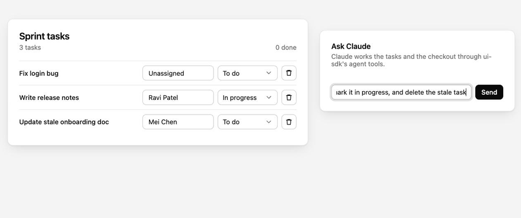
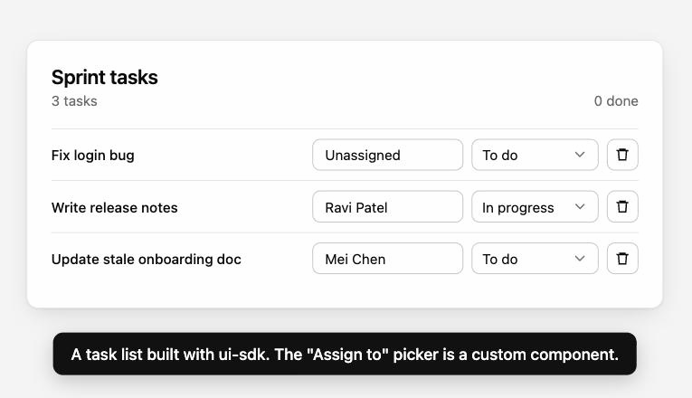

# ui-sdk agent demo

A small app built with [ui-sdk](https://github.com/vercel-labs/ui) (`0.1.0-beta.6`) that a person and an agent operate on the same screen. The agent doesn't click pixels or guess selectors: it reads the components the page exposes and calls their actions by name, and the app decides what it may do.



<sub>A live run: the request typed into Ask Claude, answered by `claude-opus-5-5` through ui-sdk's agent tools. The checkout was hidden for the recording.</sub>

```bash
npm install
npm test        # agent tests in jsdom (add --silent=false to see the snapshot)
npm run dev     # http://localhost:5173
```

## What's on the page

**Sprint tasks** (`src/tasks.tsx`): each row has an "Assign to" picker, a Status select and a Delete button that needs a person's approval (`data-agent-confirm`).

**Assign-to picker** (`src/assign-picker.ts`, 134 lines; React parts in `src/assign-picker-react.tsx`, 44 lines): a component ui-sdk doesn't ship, composed from its behaviors: a popup (open, close, focus return), a listbox (highlight, arrows, filter as you type) and a change (reports to the app). One line makes it agent-ready: `agent: { actions: ["setValue"], closed: true }`. There's no focus or keyboard code of our own. The tests in `src/assign-picker.test.tsx` were checked by breaking Enter, filtering and the agent hint one at a time; each break fails a test.

**Checkout** (`src/checkout.tsx`): Email, Card number (redacted from the agent automatically), Shipping (the app cancels agent picks over $20), Gift wrap, and a Pay button whose confirm text comes from app state.

## Drive it as an agent

From the browser console:

```js
await agent.act({ steps: [
  { ref: "Assignee for Fix login bug", action: "setValue", args: ["Jane Doe"] },
  { ref: "Status for Fix login bug", action: "setValue", args: ["In progress"] },
  { ref: "Delete Update stale onboarding doc", action: "press" },  // waits for Approve
] })
```

The first two steps run; the Delete stops at "Claude wants to: Deletes the task …" until a person clicks Approve or Deny.

 Naming someone who isn't on the team (`"Bob"`) fails with the real list of people.

Gotcha: a change the app cancels still returns `ok: true` (the step's `result` is `false`). Check `values`, not `ok`.

### Requests are data, behavior is code

`agent.act` takes a plain object, a list of `{ ref, action, args }` steps:

- `ref` is a component's name (its label) or the short id from a snapshot (`"c1"`).
- `action` must be one the component lists in its `actions` (`setValue`, `setOpen`, `press`…).
- `args` are the action's arguments; an option can be given by label (`"Mei Chen"`) or value (`"mei"`).

An unknown name, an action the component doesn't offer, or an option that doesn't exist returns an error instead of doing something. Steps marked `data-agent-confirm` still wait for a person.

The behavior itself is code. What a component can do, and how (keyboard handling, filtering, focus, what `setValue` does, which actions an agent may call), is TypeScript in `definePrimitive` (`src/assign-picker.ts`); ui-sdk's own Select and Popover are built the same way. Only two things are data: the agent's requests (the steps) and what the page reports back (the snapshot: names, values, options, actions).

It works like an HTTP API: the request body is JSON, the server's logic is code. Here the components are the server and `act` is the endpoint. Agents get a data interface because data is what a model can produce. Claude can't click, but it can emit `{ action: "setValue", args: ["Mei Chen"] }`. It can only ask for actions a component lists, never run its own code in the page.

A person never goes through this. Clicks and key presses call the same component code directly, so a person and an agent both end up in the same `setValue`.

## Talk to it through Claude

`src/tools.ts` hands ui-sdk's `agentTools` (snapshot, act, query) to Claude. The browser runs the tool loop (`src/claude-loop.ts`) because the tools act on the page. The Vite dev server's `/api/claude` route (`server/claude.ts`) makes the call, so the API key stays on the server.

```bash
echo 'ANTHROPIC_API_KEY=sk-ant-...' > .env.local   # gitignored
npm run dev
```

Type "assign the login bug to Jane, mark it in progress, and delete the stale task" in "Ask Claude". Each tool call shows up in the log, and the Delete waits for you.

### Claude decides, the page acts

Claude never touches the DOM or runs code in the page. On the Direct route:

1. Claude, on Anthropic's servers, gets the message and the tool definitions, and replies with a tool call as JSON: `act` with setValue "Mei Chen" on "Assignee for Fix login bug".
2. The page's own loop (`src/claude-loop.ts`) parses it and calls `agent.act(...)`.
3. ui-sdk finds the component by name and calls its `setValue`, the same path a click takes. React re-renders, and that's how the DOM changes.
4. The result goes back to Claude, and the loop repeats until Claude replies in text.

That's the Messages API with a small tool loop the page owns, not the Claude Agent SDK. The WebMCP route differs only in step 2: the loop hands the call to Chrome's `executeTool`, and Chrome calls the same tool.

## WebMCP: hand-written tools vs ui-sdk's generated ones

The page registers two tool sets through `document.modelContext.registerTool`. `src/webmcp.ts` records them, and passes them on to the browser's own WebMCP where it has one: Chrome 146+ with `chrome://flags/#enable-webmcp-testing`, after a full restart. There, Ask Claude calls every tool through Chrome's `executeTool`, so DevTools → Application → WebMCP lists the tools and shows each call under Tool Activity. Chrome replaces a thrown error with a generic `UnknownError`, so the hand-written tools return `{ error }` instead of throwing.

- **ui-sdk, generated:** `registerTools(agent, { allow })`, one line. `snapshot`, `act` and `query` over every component on the page.
- **Hand-written:** `src/webmcp-tools.ts`, 96 lines. `list_tasks`, `assign_task`, `set_status` and `delete_task`, written against the app's data, each checking its own arguments.

Ask Claude has two switches, because these are separate questions. Claude is the caller in every mode: it picks a tool and fills in JSON arguments, and code on the page makes the change.

1. **Who wrote Claude's tools:** **Generated by ui-sdk** (`snapshot`, `act` and `query`, from the components, with no tool code written) or **Written by you** (`assign_task` and the rest, each with its own `execute`).
2. **How Claude's calls reach the page:** **Through WebMCP** sends every call through the browser's `executeTool`, so DevTools shows it under Tool Activity. **Direct** has the page call the tool itself, `agent.act()` or your function, with no WebMCP: the page changes the same way, and Tool Activity stays empty.

`agent` (from `createAgent()`) is not an AI. It's the page's interface for one: it lists the components, checks each step, and calls the component's action.

ui-sdk doesn't need WebMCP. `registerTools(agent)` is one optional way to publish its bridge, and the Direct route never uses it.

Results with `claude-opus-5-5` on 2026-11-18:

| Request | ui-sdk | Hand-written | Both |
| --- | --- | --- | --- |
| "Assign the login bug to Jane, mark it in progress, and delete the stale task" | 2 calls (snapshot, one act), ~5 s, waits at Delete | 4 calls (list, assign, status, delete), ~6 s, waits at Delete | Claude picks the hand-written tools |
| "In the checkout, choose express shipping and turn on gift wrap" | works | "none of the tools this page gives me work with the checkout" | Claude uses ui-sdk's act; total $50 |

What it shows:

- **Named tools win when they exist.** Given both, Claude chose `assign_task` over `act`. They read like the business operation and need no snapshot.
- **Hand-written tools only cover what someone wrote.** The checkout has no hand-written tools, so that agent can't touch it. ui-sdk's one line covers every component, including ones added later.
- **The approval isn't free with WebMCP.** The spec has no confirmation API yet (only a `consequentialHint` annotation the browser may act on), so `delete_task` asks the person in its own code. Forget that line and the agent deletes without asking. With ui-sdk, `data-agent-confirm` on the button covers every path to it.
- **Both use one channel.** ui-sdk's tools are WebMCP tools; a page can offer named tools for its key operations and ui-sdk for the rest of the screen.

## What this shows

- **An API the UI exposes to agents.** `snapshot()` lists each component, its label, value, items and actions. `act()` calls an action through the component's own change path, so app state, callbacks and rules run as they would for a person, and the person sees it happen.
- **The app stays in charge.** Every agent change arrives with `details.source === "agent"`, so the app can `cancel()` it (the shipping cap), require a person (`data-agent-confirm`), hide a value (`data-agent-secret`) or hide a region (`data-agent-hidden`).
- **Versus computer use, browser automation or jQuery.** Those infer intent from screenshots, the DOM or selectors and bypass the app's logic. Here the page describes itself, and the calls go through the components.
- **Versus WebMCP.** WebMCP is the channel for a page to offer tools to an in-browser agent; you hand-write each tool. ui-sdk generates generic tools from the UI, and `registerTools` publishes them through WebMCP. Both fit in one app: named tools for the key operations, ui-sdk for the rest of the screen.
- **The gap: existing apps.** Only ui-sdk components show up in `snapshot()`. A plain `<button>` or `<select>`, or an existing component or web component library, is invisible to the agent until it's moved onto ui-sdk parts or behaviors. The docs offer no adapter for components you already have.
